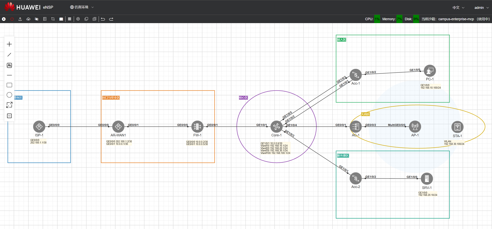

# eNSP-Pro MCP

把 **eNSP Pro** 的沙箱、设备、连线、拓扑、Console 和命令执行能力，通过标准 **MCP（Model Context Protocol）** 协议暴露给 AI Agent，让「用一句话搭实验拓扑、敲设备命令」成为现实。

**无需模拟器自带 API、无需二次登录、无需外网**：复用浏览器里已经登录的 eNSP 页面会话，离线也能跑。

[](LICENSE)


---

<!-- 配图位：把截图放到 docs/images/preview.png，下面这段会自动显示；没放图前显示 alt 文本 -->


> 建议截图内容：AI 客户端里一句「在沙箱 16 上执行 display version」→ 返回设备版本信息，或拓扑自动标注效果图。

---

## 一、它能做什么

- **一句话建拓扑**：创建沙箱、批量放设备、连线、启停设备、等待全部就绪
- **一句话敲命令**：自动打开 Console、识别提示符、自动应答 `[Y/N]`，返回清洗后的输出
- **拓扑可视化**：矩形、椭圆、文本标注，坐标与 Web 画布一致
- **运维自助**：查询服务器 CPU / 内存 / 磁盘占用，与 Web 面板显示完全一致
- **离线可用**：执行一次 `npm install` 装好依赖后，之后可完全断网运行

## 二、工作原理

```
AI Agent（Trae / VSCode / Claude 等）
   │  MCP 协议（stdio）
   ▼
mcp/server.js  ──HTTP──▶  bridge/server.js（127.0.0.1:8790）
                              │  WebSocket（扩展反向连入）
                              ▼
                        扩展 background.js
                              │  chrome.tabs.sendMessage
                              ▼
                        扩展 content.js（运行在 eNSP 页面内）
                              │  fetch（自动带登录 Cookie / CSRF）
                              ▼
                        eNSP Pro Web 服务器
```

- **mcp/**：注册工具、校验参数、转发调用；启动时自动拉起 bridge，bridge 掉线会自动重连
- **bridge/**：本地中间层。浏览器不能监听端口，所以由扩展主动连入，MCP 通过 HTTP 调用
- **extension/**：在 eNSP 页面上下文发请求，天然复用登录态；负责 Console 会话与提示符识别

## 三、环境要求

| 项目 | 要求 |
|---|---|
| Node.js | ≥ 18（建议 20 / 22），确保 `node` 在 PATH 中 |
| 浏览器 | Chrome / Edge 等 Chromium 内核浏览器 |
| eNSP Pro | 能访问并已登录 Web 管理页面（默认 `https://10.10.10.130:8443`） |
| 系统 | Windows 10 / 11（其他系统理论可用，未做验证） |

## 四、快速开始

### 第 1 步：安装依赖

```bash
npm install
```

依赖已锁定在 `package-lock.json` 中，装一次即可，之后可离线运行。

### 第 2 步：加载浏览器扩展

1. 打开 `chrome://extensions`（Edge 为 `edge://extensions`）
2. 打开右上角「开发者模式」
3. 点击「加载已解压的扩展程序」，选择本目录下的 `extension` 文件夹
4. 打开 eNSP 页面并登录，扩展图标徽章变为 **ON** 即表示通道已建立

> 如果你的 eNSP 服务器地址不是 `10.10.10.130:8443`，需要修改 `extension/manifest.json` 中的 `host_permissions`、`content_scripts.matches` 以及 `extension/background.js` 里的 `PAGE_MATCH`，然后在扩展页点「重新加载」。

### 第 3 步：注册 MCP 服务

在 AI 客户端的 MCP 配置文件中加入一条（**`cwd` 指向本目录**，即 `mcp/` 的上级目录）：

```json
{
  "mcpServers": {
    "ensp-pro-mcp": {
      "command": "node",
      "args": ["mcp/server.js"],
      "cwd": "D:\\path\\to\\eNSP-Pro-MCP",
      "disabled": false
    }
  }
}
```

- Windows 下若 `node` 不在 PATH，把 `command` 换成 node 绝对路径，例如 `C:\\Program Files\\nodejs\\node.exe`
- 修改配置后**重载窗口 / 重启客户端**，工具列表才会刷新
- 无需手动启动 bridge：MCP 服务启动后会在后台自动拉起；排障时可前台运行 `node bridge/server.js` 观察日志

### 第 4 步：直接对话
对 AI 说这些话即可，不用手写工具参数：

- 「列出当前所有沙箱」→ `get_sandboxes`
- 「查一下服务器 CPU / 内存 / 磁盘占用」→ `get_resource_usage`
- 「在沙箱 16 上执行 `display version`」→ `run_commands`
- 「等所有设备启动完成」→ `wait_devices_ready`

## 五、工具清单（共 37 个）

| 分组 | 工具 |
|---|---|
| 沙箱 | `get_sandboxes` `get_sandbox` `create_sandbox` `delete_sandbox` |
| 设备 | `get_device_types` `get_device_status` `get_device_positions` `create_devices` `move_device` `delete_devices` `start_devices` `stop_devices` `reboot_devices` `wait_devices_ready` |
| 链路 | `create_link` `delete_link` |
| 拓扑 | `validate_topology` |
| Console | `console_open` `console_wait_ready` `console_write` `console_read` `console_execute` `console_close` |
| 终端配置 | `get_terminal_config` `set_terminal_config` `set_terminal_ipv4` `set_terminal_ipv6` |
| 命令执行 | `run_commands` |
| 图形标注 | `list_graphics` `add_graphics` `update_graphic` `delete_graphics` `add_text` `update_text` `delete_texts` |
| 诊断/监控 | `ws_diagnostics` `get_resource_usage` |

## 六、常见问题

| 现象 | 原因与处理 |
|---|---|
| 调用报「本地桥未启动」 | bridge 未拉起：手动执行 `node bridge/server.js`；或检查 8790 端口是否被占用 |
| 扩展徽章一直是 OFF | eNSP 页面未打开或未登录；登录后自动连接 |
| 工具列表为空 | 改完配置未重载客户端，重载窗口即可 |
| 端口冲突 `EADDRINUSE` | 设置环境变量 `ENSP_BRIDGE_PORT` 换端口（MCP 与 bridge 需一致） |
| 返回「登录失效」 | 浏览器侧 eNSP 会话过期，重新登录页面 |

## 七、目录结构

```
eNSP-Pro-MCP/
├── mcp/             MCP stdio 服务端
├── bridge/          本地桥服务（127.0.0.1:8790）
├── extension/       Chrome/Edge 扩展（Manifest V3）
├── scripts/         辅助脚本（拓扑批量标注等）
├── node_modules/    运行依赖（npm install 生成，不纳入版本库）
└── docs/images/     文档配图目录
```

## 八、安全说明

- 本工具面向**内网实验环境**，默认目标为私网地址，请勿直接暴露到公网
- bridge 仅监听回环地址 `127.0.0.1`，本机任意进程均可调用；如需跨机使用请自行加鉴权
- 设备默认 Console 密码为 eNSP 默认值，请在正式环境中自行修改

## 九、许可证

本项目采用 **GNU General Public License v3.0（GPL-3.0）**。

这意味着：你可以自由使用、修改和分发本软件，但**基于本项目的修改版本在分发时也必须以 GPL-3.0 开源**，并保留原作者版权声明。完整条款见 [LICENSE](LICENSE)。

## 十、免责声明

本项目为个人开源作品，与华为技术有限公司及 eNSP 官方无关，不使用、不修改其任何二进制程序。请仅在你拥有合法授权的环境中使用。

---

## 🤝 寻找工作机会 | Open to Work

目前 23 岁，待业中，正在寻找网络工程师相关工作机会。

如果你认可我的技术作品，对我的项目感兴趣，并且团队恰好需要一名网络工程师，我非常希望有机会加入你们，与团队一起学习、成长和创造价值。

无论是网络工程、网络自动化，还是网络技术研发，我都愿意尝试。

**联系方式：**
- 微信：LCD4007
- QQ：3051547266

欢迎联系，期待有机会加入你的团队！

